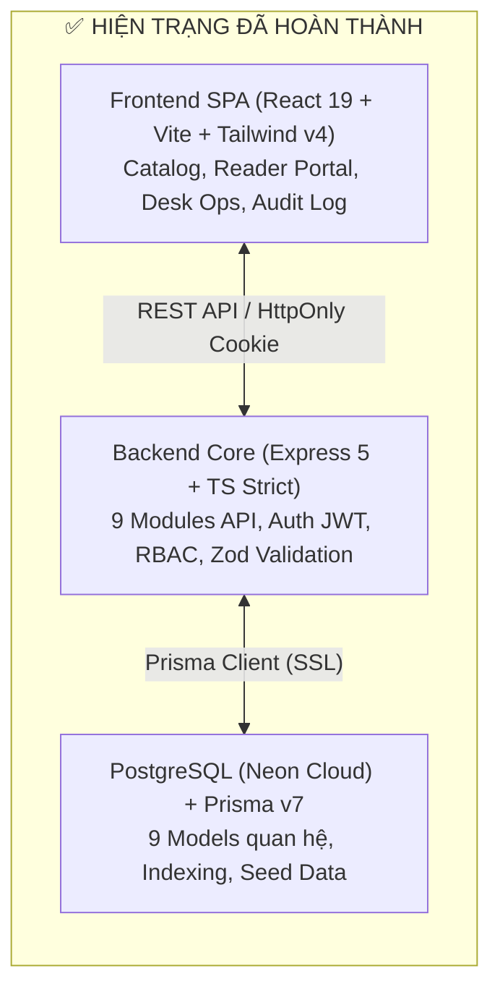
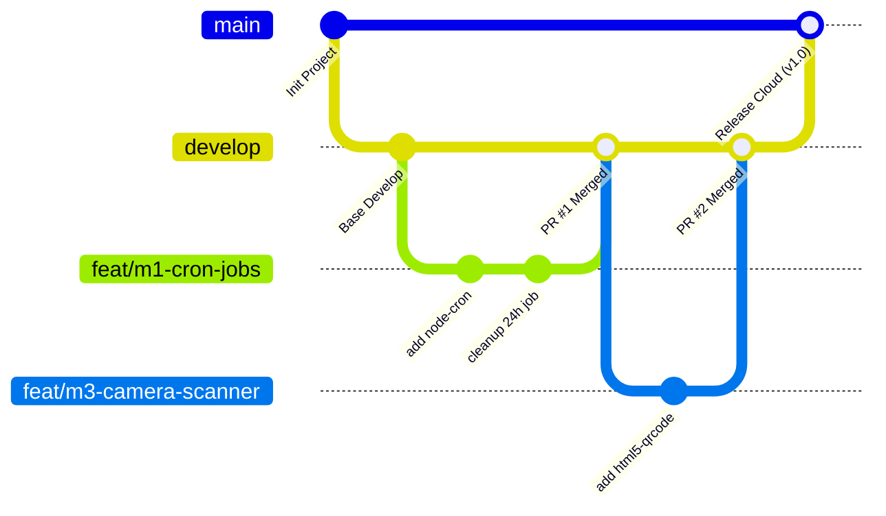

# BÁO CÁO HIỆN TRẠNG & KẾ HOẠCH PHÂN CÔNG THỰC HIỆN DỰ ÁN
## HỆ THỐNG QUẢN LÝ THƯ VIỆN (LIBRARY MANAGEMENT SYSTEM - LMS)

> **Thông tin tổng quan:**  
> - **Mô hình triển khai:** Nhóm 4 người — Node.js 20 LTS (Local) + Neon PostgreSQL + Render (Backend) + Vercel (Frontend) *(Không dùng Docker)*  
> - **Nguyên tắc thực hiện:** Phân công theo đầu việc cụ thể (Task-Driven), làm việc độc lập song song 100% (không ai phải chờ ai), tập trung hoàn thiện toàn diện sản phẩm sẵn sàng cho buổi Demo nghiệm thu.  

---

## PHẦN 1: BÁO CÁO NHỮNG GÌ ĐÃ HOÀN THÀNH

Dự án hiện đã hoàn tất xây dựng **Core Backend (Express 5 + TypeScript + Prisma)** và **Giao diện Frontend MVP (React 19 + Vite + Tailwind CSS v4)**. Cả hai phân hệ đều biên dịch thành công (build sạch, không phát sinh lỗi TypeScript hay Linting).



### 1. Phân hệ Backend (Node.js + Express 5 + TypeScript + Prisma)

Backend được tổ chức theo kiến trúc **Modular Layered Architecture** chuẩn mực (`routes` $\rightarrow$ `schema` $\rightarrow$ `controller` $\rightarrow$ `service`):

- **Xác thực & Bảo mật (Auth & RBAC):**
  - Đăng ký, đăng nhập với mã hóa mật khẩu `bcryptjs`.
  - Cơ chế Token kép: JWT Access Token lưu trong bộ nhớ/session và Refresh Token qua HttpOnly Cookie an toàn chống tấn công XSS.
  - Phân quyền theo 3 vai trò nghiêm ngặt: `READER` (Độc giả), `LIBRARIAN` (Thủ thư), `ADMIN` (Quản trị viên).
  - Tích hợp lớp phòng thủ: `helmet`, `cors`, `cookie-parser`, `express-rate-limit` chống Brute-force.
- **Quản lý Danh mục, Sách & Bản sao vật lý (Catalog & Inventory):**
  - Quản lý thể loại sách (`Category`) theo slug định danh duy nhất.
  - Quản lý đầu sách (`Book`): Tìm kiếm mờ theo tiêu đề, tác giả, ISBN; lọc theo danh mục; hỗ trợ phân trang chuẩn hóa.
  - Quản lý bản sao vật lý (`BookCopy`): Mỗi bản sao có Barcode duy nhất, vị trí kệ (`shelfLocation`), và trạng thái cụ thể (`AVAILABLE`, `RESERVED`, `BORROWED`, `DAMAGED`, `LOST`).
- **Nghiệp vụ Mượn / Trả & Concurrency Control (Borrow Engine):**
  - **Đặt sách trước (Reservation):** Tự động khóa bản sao trong 24 giờ. Kiểm tra hạn mức mượn tối đa (5 cuốn) và chặn người dùng có nợ phạt vượt ngưỡng. Toàn bộ logic chạy trong **Prisma Transaction** để triệt tiêu race condition (chống mượn trùng cuốn sách cuối cùng).
  - **Checkout tại quầy:** Thủ thư có thể quét/nhập nhiều bản sao cùng lúc cho 1 độc giả, kiểm tra trùng mã và cập nhật tồn kho tức thì.
  - **Trả sách (Return) & Tính phạt tự động:** Tiếp nhận và phân loại tình trạng sách (`GOOD`, `LIGHT_DAMAGE`, `HEAVY_DAMAGE`, `LOST`). Tự động tính phí trả trễ (5.000 VNĐ/ngày, có ân hạn 1 ngày, áp trần 150% giá sách) và phí bồi thường hư hại/mất sách.
  - **Gia hạn sách (Renew):** Cho phép độc giả tự gia hạn tối đa 2 lần (+7 ngày/lần) nếu sách chưa bị quá hạn.
- **Quản lý Tiền phạt & Nhật ký kiểm toán (Fine & Audit Log):**
  - Quản lý danh sách phạt, xác nhận thu tiền (`settle`).
  - Phê duyệt miễn giảm phạt (`waive`) dành riêng cho Admin (bắt buộc nhập lý do).
  - Tự động ghi vết thao tác miễn phạt và thay đổi trạng thái người dùng vào bảng `audit_logs`.

---

### 2. Phân hệ Cơ sở dữ liệu (PostgreSQL & Prisma ORM)

- Schema gồm 9 bảng thực thể liên kết chặt chẽ: `users`, `categories`, `books`, `book_copies`, `borrow_records`, `borrow_items`, `fines`, `system_settings`, `audit_logs`.
- Đánh chỉ mục (`@@index`) tối ưu hóa truy vấn tìm kiếm theo `email`, `role`, `isbn`, `barcode`, `dueDate`, `status`.
- Script seed dữ liệu mẫu (`prisma/seed.ts`) hoàn chỉnh, nạp sẵn tài khoản mẫu cho cả 3 vai trò cùng kho sách mẫu phong phú.

---

### 3. Phân hệ Frontend (React 19 + TypeScript + Vite + Tailwind CSS v4)

Giao diện SPA tuân theo ngôn ngữ thiết kế **“Quiet Academic Library”** (trang nhã, tập trung vào khả năng tra cứu và tốc độ thao tác tại quầy):

- **Xử lý State & Tự động Refresh Token:** Axios client tập trung, tự động bắt lỗi `401` để kích hoạt endpoint refresh token ngầm và retry request mà không làm gián đoạn người dùng.
- **Màn hình Độc giả (Reader):**
  - Tra cứu kho sách trực tuyến, xem vị trí kệ sách và tình trạng còn/hết.
  - Đặt giữ chỗ sách online (`Reserve`).
  - Trang cá nhân: Theo dõi danh sách sách đang mượn, lịch sử mượn, tự bấm gia hạn sách, theo dõi phí phạt cá nhân và xem mã QR định danh cá nhân.
- **Màn hình Vận hành (Librarian / Admin):**
  - Dashboard vận hành: Thống kê KPI tổng quan (đầu sách, bản sao khả dụng, đang mượn, quá hạn, nợ phạt).
  - Quản lý đầu sách, bản sao vật lý và danh mục sách.
  - Quầy Checkout: Nhập danh sách barcode, kiểm tra trùng lặp và xác nhận giao dịch.
  - Quầy Return: Tiếp nhận trả sách, đánh giá hỏng/mất.
  - Quản lý thu tiền phạt và miễn giảm tiền phạt.
  - Trang Audit Logs dành riêng cho Admin truy vết thao tác hệ thống.

---

## PHẦN 2: BẢNG PHÂN CÔNG CHI TIẾT TỪNG ĐẦU VIỆC CẦN LÀM

### 🔴 MEMBER 1: TECH LEAD & AUTOMATION / CLOUD DEPLOYMENT

#### Việc 1.1: Tự động hóa hủy phiếu đặt mượn sau 24h
* **Mục tiêu:** Xử lý việc độc giả đặt sách giữ chỗ nhưng quá 24h không đến lấy thì tự động hủy và trả lại sách về kho khả dụng.
* **File cần tạo:** `src/jobs/reservation-cleanup.job.ts`
* **Thư viện cài đặt:** `npm install node-cron @types/node-cron`
* **Checklist hoàn thành:**
  - [ ] Viết hàm quét các phiếu trong bảng `borrow_records` có `status = 'RESERVED'` và `expiresAt < new Date()`.
  - [ ] Chạy trong Prisma Transaction: Cập nhật trạng thái phiếu sang `CANCELLED`.
  - [ ] Cập nhật bản sao `BookCopy` về `AVAILABLE`, tăng số lượng `availableCopies` của `Book` lên 1.
  - [ ] Đặt lịch chạy định kỳ mỗi 15 phút (`*/15 * * * *`).
  - [ ] Đăng ký khởi chạy job trong `src/server.ts`.

#### Việc 1.2: Tự động hóa quét và cập nhật sách quá hạn
* **Mục tiêu:** Hàng ngày quét các phiếu mượn chưa trả mà đã quá hạn để chuyển trạng thái sang `OVERDUE`.
* **File cần tạo:** `src/jobs/overdue-check.job.ts`
* **Checklist hoàn thành:**
  - [ ] Viết hàm quét các phiếu mượn có `status = 'BORROWED'` và `dueDate < new Date()`.
  - [ ] Cập nhật trạng thái phiếu sang `OVERDUE`.
  - [ ] Đặt lịch chạy lúc 00:00 hàng ngày (`0 0 * * *`).
  - [ ] Đăng ký khởi chạy job trong `src/server.ts`.

#### Việc 1.3: Dịch vụ gửi Email thông báo mượn sách & nhắc hạn
* **Mục tiêu:** Gửi email xác nhận khi checkout mượn sách thành công và gửi email nhắc nhở trước 1–2 ngày khi tới hạn trả.
* **File cần tạo:** `src/services/email.service.ts`
* **Thư viện cài đặt:** `npm install nodemailer @types/nodemailer`
* **Checklist hoàn thành:**
  - [ ] Cấu hình transporter gửi mail (dùng tài khoản Ethereal test hoặc Gmail App Password / Resend API).
  - [ ] Thiết kế mẫu email HTML: Lời chào độc giả, danh sách các cuốn sách đã mượn kèm ngày hẹn trả.
  - [ ] Gọi hàm gửi email trong `src/modules/borrow/borrow.service.ts` ngay sau khi checkout thành công.
  - [ ] Viết cron job chạy 08:00 sáng quét các phiếu mượn còn 1–2 ngày đến hạn để gửi email nhắc nhở độc giả.

#### Việc 1.4: Triển khai toàn bộ hệ thống lên Cloud (Render & Vercel)
* **Mục tiêu:** Đưa hệ thống lên internet chạy online 100%, phục vụ việc cầm điện thoại demo trực tiếp.
* **Nền tảng:** Render.com (Backend) + Vercel (Frontend) + Neon (PostgreSQL).
* **Checklist hoàn thành:**
  - [ ] Tạo Web Service trên **Render.com** (liên kết repo GitHub, build command: `npm install && npm run build`, start command: `npm start`).
  - [ ] Điền toàn bộ biến môi trường trên Render: `DATABASE_URL`, `JWT_ACCESS_SECRET`, `JWT_REFRESH_SECRET`, `CORS_ORIGIN`.
  - [ ] Tạo Project trên **Vercel** cho thư mục `frontend`: Cấu hình `VITE_API_URL` trỏ về domain Render.
  - [ ] Cấu hình CORS tại `src/app.ts` chấp nhận domain Vercel và cho phép truyền cookie (`credentials: true`).
  - [ ] Kiểm tra đăng nhập, lưu cookie refresh token mượt mà trên môi trường HTTPS.

---

### 🔵 MEMBER 2: BACKEND BUSINESS & DATA SERVICES

#### Việc 2.1: Xây dựng API Lookup phục vụ quầy mượn / trả
* **Mục tiêu:** Hỗ trợ quét mã camera: Quét mã barcode trên sách là lập tức tra ra thông tin phiếu mượn tương ứng mà không phải gõ ID thủ công.
* **File cần sửa/thêm:** `src/modules/borrow/borrow.controller.ts`, `borrow.service.ts`, `borrow.routes.ts`
* **Checklist hoàn thành:**
  - [ ] Viết API `GET /api/v1/borrows/lookup?barcode=...`:
    - Tìm bản sao sách `BookCopy` theo barcode.
    - Tìm phiếu mượn `BorrowRecord` đang ở trạng thái `BORROWED` có chứa bản sao này.
    - Trả về thông tin: ID phiếu mượn, tên độc giả, email, ngày mượn, hạn trả, trạng thái quá hạn.
  - [ ] Viết API `GET /api/v1/users/lookup?qrCode=...`: Tìm độc giả theo mã QR cá nhân để điền nhanh vào quầy Checkout.

#### Việc 2.2: API sinh mã Base64 cho QR Code độc giả và Barcode sách
* **Mục tiêu:** Trả về chuỗi ảnh Base64 để hiển thị mã vạch lên thẻ độc giả hoặc in dán lên gáy sách.
* **Thư viện cài đặt:** `npm install qrcode @types/qrcode`
* **Checklist hoàn thành:**
  - [ ] Viết API `GET /api/v1/users/:id/qrcode`: Sinh ảnh QR Data URL từ chuỗi `user.qrCode`.
  - [ ] Viết API `GET /api/v1/book-copies/:id/barcode`: Sinh ảnh mã vạch từ chuỗi `barcode`.

#### Việc 2.3: Tích hợp Upload ảnh bìa sách Cloudinary
* **Mục tiêu:** Cho phép upload file ảnh từ máy tính thay vì phải nhập text link URL.
* **File cần tạo:** `src/middlewares/upload.middleware.ts`
* **Thư viện cài đặt:** `npm install multer cloudinary multer-storage-cloudinary @types/multer`
* **Checklist hoàn thành:**
  - [ ] Đăng ký tài khoản Cloudinary miễn phí, lấy `cloud_name`, `api_key`, `api_secret`.
  - [ ] Cấu hình storage multer upload ảnh trực tiếp lên Cloudinary.
  - [ ] Gắn middleware upload vào route `POST /api/v1/books` và `PATCH /api/v1/books/:id`.
  - [ ] Lưu đường dẫn ảnh trả về vào trường `coverImageUrl` của bảng Book.

#### Việc 2.4: Bổ sung API Báo cáo thống kê chuyên sâu
* **Mục tiêu:** Cung cấp dữ liệu thống kê trực quan cho các biểu đồ ở Frontend.
* **File cần sửa:** `src/modules/report/report.service.ts`, `report.controller.ts`, `report.routes.ts`
* **Checklist hoàn thành:**
  - [ ] Viết API `GET /api/v1/reports/top-books`: Thống kê 10 đầu sách có số lượt mượn nhiều nhất.
  - [ ] Viết API `GET /api/v1/reports/monthly-trends`: Thống kê số lượng mượn và trả theo từng tháng (6 tháng gần nhất).
  - [ ] Viết API `GET /api/v1/reports/categories-ratio`: Thống kê tỷ lệ phân bổ sách theo từng thể loại.

#### Việc 2.5: Xuất dữ liệu báo cáo ra file Excel
* **Mục tiêu:** Bấm nút là tải về file Excel danh sách phiếu mượn và danh sách sách quá hạn.
* **Thư viện cài đặt:** `npm install exceljs`
* **Route:** `GET /api/v1/reports/export/excel`
* **Checklist hoàn thành:**
  - [ ] Tạo Workbook và Worksheet bằng `exceljs`.
  - [ ] Thêm các cột: STT, Mã phiếu, Tên độc giả, Tên sách, Barcode, Ngày mượn, Ngày hẹn trả, Trạng thái.
  - [ ] Định dạng bảng tính: Chữ in đậm tiêu đề, kẻ viền ô, tô màu header, tự động căn chỉnh độ rộng cột.
  - [ ] Xuất stream trả về dạng file `.xlsx` cho trình duyệt tải xuống.

---

### 🟢 MEMBER 3: FRONTEND LEAD & SCANNER SPECIALIST

#### Việc 3.1: Xây dựng Component Camera Scanner dùng chung
* **Mục tiêu:** Mở camera máy tính hoặc camera sau điện thoại để quét mã vạch và QR code.
* **File cần tạo:** `frontend/src/components/scanner.tsx`
* **Thư viện cài đặt:** `cd frontend && npm install html5-qrcode`
* **Checklist hoàn thành:**
  - [ ] Tạo Component `<CameraScanner onScan={(resultText) => void} onClose={() => void} />`.
  - [ ] Khởi tạo đối tượng `Html5QrcodeScanner`.
  - [ ] Cấu hình quét cả mã QR và mã Barcode 1D (Code128, EAN13).
  - [ ] Bắt sự kiện quét thành công và trả về chuỗi text mã vạch.

#### Việc 3.2: Tích hợp Camera Scanner vào Quầy Checkout (Mượn sách)
* **File cần sửa:** `frontend/src/pages/operations.tsx` (`CheckoutPage`)
* **Checklist hoàn thành:**
  - [ ] Thêm nút icon Camera cạnh ô "Mã độc giả": Bấm vào mở modal camera $\rightarrow$ quét mã QR thẻ độc giả $\rightarrow$ tự điền mã vào ô.
  - [ ] Thêm nút icon Camera tại danh sách "Barcode sách": Cho phép quét liên tục nhiều cuốn sách.
  - [ ] Tự động kiểm tra trùng lặp barcode và giới hạn tối đa 5 cuốn mỗi phiên.

#### Việc 3.3: Tích hợp Camera Scanner vào Quầy Return (Trả sách)
* **File cần sửa:** `frontend/src/pages/operations.tsx` (`ReturnPage`)
* **Checklist hoàn thành:**
  - [ ] Thêm nút bật camera quét mã vạch trên cuốn sách mang đến trả.
  - [ ] Khi quét được mã barcode $\rightarrow$ tự động gọi API lookup của Member 2.
  - [ ] Tự động hiển thị chi tiết phiếu mượn, tên người mượn, số ngày trễ (nếu có).
  - [ ] Hiển thị lựa chọn đánh giá tình trạng sách: *Bình thường, Hỏng nhẹ, Hỏng nặng, Bị mất*.
  - [ ] Bấm xác nhận trả sách và hiển thị số tiền phạt tự động sinh ra (nếu có).

#### Việc 3.4: Nâng cấp Dashboard Báo cáo với biểu đồ Recharts
* **File cần sửa:** `frontend/src/pages/operations.tsx` (`ReportsPage`)
* **Thư viện cài đặt:** `cd frontend && npm install recharts`
* **Checklist hoàn thành:**
  - [ ] Tích hợp `BarChart`: Hiển thị Top 10 cuốn sách được mượn nhiều nhất.
  - [ ] Tích hợp `LineChart` / `AreaChart`: Thể hiện số lượt mượn/trả theo từng tháng.
  - [ ] Tích hợp `PieChart`: Cơ cấu tỷ lệ sách theo các thể loại.
  - [ ] Thêm nút bấm "Tải báo cáo Excel" kết nối với API của Member 2.

#### Việc 3.5: Tinh chỉnh Responsive Mobile & Toast Notifications
* **Checklist hoàn thành:**
  - [ ] Kiểm tra và chỉnh sửa CSS trên màn hình điện thoại (đảm bảo lúc demo cầm smartphone mở quầy quét mã không bị vỡ giao diện).
  - [ ] Cài đặt thư viện Toast thông báo (hoặc popup nhẹ) thay cho các lệnh `alert()` thông thường.
  - [ ] Xử lý hiển thị thông báo lỗi khi mất mạng kèm nút "Thử lại".

---

### 🟣 MEMBER 4: QA / TESTING & DEMO MASTER

#### Việc 4.1: Thiết lập môi trường kiểm thử tự động với Jest & Supertest
* **File cấu hình:** `jest.config.js`
* **Thư viện cài đặt:** `npm install -D jest ts-jest @types/jest supertest @types/supertest`
* **Checklist hoàn thành:**
  - [ ] Khởi tạo thư mục `tests/`.
  - [ ] Tạo file cấu hình `jest.config.js` hỗ trợ TypeScript.
  - [ ] Thêm script `"test": "jest --detectOpenHandles --forceExit"` vào file `package.json`.

#### Việc 4.2: Viết bài test Concurrency (Chống Race Condition)
* **File cần tạo:** `tests/concurrency.test.ts`
* **Mục tiêu:** Tạo bằng chứng kỹ thuật chứng minh hệ thống xử lý đúng khi 2 người cùng tranh chấp mượn 1 cuốn sách duy nhất.
* **Checklist hoàn thành:**
  - [ ] Chuẩn bị dữ liệu test: 1 đầu sách chỉ có đúng 1 bản sao `BookCopy` trạng thái `AVAILABLE`.
  - [ ] Sử dụng `Promise.all` gửi đồng thời 2 request đặt mượn từ 2 tài khoản độc giả khác nhau.
  - [ ] Kiểm chứng kết quả (Assert):
    - ĐÚNG 1 request nhận mã phản hồi thành công (HTTP 200 / 201).
    - ĐÚNG 1 request nhận mã lỗi xung đột (HTTP 409 Conflict).
    - Tồn kho khả dụng `availableCopies` của sách về đúng bằng 0, không bị âm số lượng.

#### Việc 4.3: Viết Unit / Integration Test cho các luồng cốt lõi
* **File cần tạo:** `tests/auth.test.ts`, `tests/borrow.test.ts`
* **Checklist hoàn thành:**
  - [ ] Test Auth: Đăng ký thành công, chặn trùng email, đăng nhập sai pass trả về 401, bảo vệ route bằng RBAC.
  - [ ] Test Borrow & Return:
    - Mượn sách thành công trừ tồn kho.
    - Trả sách quá hạn $\rightarrow$ tính đúng phí phạt 5.000 VNĐ/ngày (sau ân hạn 1 ngày).
    - Trả sách báo hỏng nhẹ $\rightarrow$ tính đúng 20% giá bìa.
    - Gia hạn sách quá 2 lần $\rightarrow$ bị chặn.

#### Việc 4.4: Chuẩn hóa bộ dữ liệu mẫu (Seed Data)
* **File cần sửa:** `prisma/seed.ts`
* **Mục tiêu:** Khi demo dữ liệu phải phong phú, đẹp mắt như một thư viện thật đang vận hành.
* **Checklist hoàn thành:**
  - [ ] Bổ sung ít nhất 20 đầu sách thuộc nhiều thể loại, có ảnh bìa thật sắc nét từ Unsplash hoặc link ảnh chuẩn.
  - [ ] Tạo 5 tài khoản độc giả mẫu (`reader1`, `reader2`...).
  - [ ] Tạo sẵn 3 phiếu mượn đang mượn bình thường.
  - [ ] Tạo sẵn 2 phiếu mượn đã bị quá hạn để hiển thị số cảnh báo đỏ trên dashboard.
  - [ ] Tạo sẵn 1 khoản phạt chưa thanh toán và 1 khoản phạt đã được thanh toán.

#### Việc 4.5: Soạn Kịch bản Demo phân vai chi tiết & Video dự phòng
* **File cần tạo:** `DEMO_SCRIPT.md`
* **Mục tiêu:** Từng thành viên biết chính xác mình làm gì, nói gì lúc demo trước giảng viên.
* **Checklist hoàn thành:**
  - [ ] Viết kịch bản Demo phân vai theo trình tự 5 bước:
    1. *Bước 1 (Độc giả):* Đăng nhập trên điện thoại $\rightarrow$ Tìm kiếm sách $\rightarrow$ Bấm đặt trước giữ chỗ 24h.
    2. *Bước 2 (Thủ thư tại quầy Checkout):* Dùng webcam/smartphone quét mã QR độc giả $\rightarrow$ Quét barcode sách $\rightarrow$ Xác nhận mượn $\rightarrow$ Độc giả nhận email thông báo.
    3. *Bước 3 (Thủ thư tại quầy Return):* Quét barcode sách mang trả $\rightarrow$ Báo sách bị "Hỏng nhẹ" $\rightarrow$ Hệ thống tự sinh khoản phạt.
    4. *Bước 4 (Admin):* Thu tiền phạt hoặc duyệt miễn giảm phạt có lý do $\rightarrow$ Mở Audit Log kiểm tra lịch sử thao tác.
    5. *Bước 5 (Báo cáo):* Mở trang Reports xem biểu đồ Recharts và bấm tải file Excel.
  - [ ] **Quay 01 Video clip Demo hoàn chỉnh (5 - 7 phút):** Quay màn hình toàn bộ thao tác theo đúng kịch bản, lưu vào Google Drive để làm phương án dự phòng khi hội trường mất mạng.

#### Việc 4.6: Thiết kế Slide thuyết trình chuyên nghiệp
* **Công cụ:** Canva hoặc PowerPoint (15 – 20 slide)
* **Nội dung slide:**
  - [ ] Slide 1: Tên đề tài, Giảng viên hướng dẫn & Danh sách 4 thành viên.
  - [ ] Slide 2: Đặt vấn đề và bài toán quản lý thư viện số hóa.
  - [ ] Slide 3: Kiến trúc tổng thể hệ thống (Tech Stack: Express 5, React 19, Neon PostgreSQL, Cloud Render/Vercel).
  - [ ] Slide 4: Thiết kế Cơ sở dữ liệu (Sơ đồ ERD 9 thực thể).
  - [ ] Slide 5: Quy tắc nghiệp vụ cốt lõi (Hạn mượn, giữ chỗ 24h, công thức tính phạt, ân hạn).
  - [ ] Slide 6 – 10: Các điểm nổi bật kỹ thuật (Xử lý Race condition, Quét Camera Scanner, Tự động hóa Background Cron, Xuất Excel).
  - [ ] Slide 11: Kết quả kiểm thử tự động (Jest test suite).
  - [ ] Slide 12: Trực tiếp tiến hành Demo phần mềm.
  - [ ] Slide 13: Kết luận, Đánh giá kết quả & Hướng phát triển trong tương lai.

---

## PHẦN 3: NGUYÊN TẮC LÀM VIỆC ĐỘC LẬP SONG SONG (KHÔNG CẦN CHỜ ĐỢI)

Cả 4 thành viên hoàn toàn có thể bắt tay vào làm việc ngay từ ngày đầu tiên mà **không ai phải ngồi chờ ai** nhờ vào các cơ chế phân tách sau:

1. **Member 3 (Frontend) làm độc lập không cần chờ Member 2 (Backend):**
   - **Với Camera Scanner:** Member 3 cài thư viện `html5-qrcode` và bật camera quét bất kỳ mã vạch nào quanh phòng (hộp bánh, sách có sẵn) để hoàn thiện giao diện và sự kiện quét.
   - **Với Biểu đồ Recharts:** Member 3 dùng mảng dữ liệu giả (`mock data`) ngay trong component để dựng biểu đồ, căn chỉnh màu sắc, responsive trước. Khi Member 2 làm xong API, chỉ mất đúng **2 phút** để đổi sang gọi API thật.
2. **Member 1 (Tech Lead) làm độc lập:**
   - Viết Cron jobs và Email service chạy ngầm độc lập với giao diện.
   - Cấu hình Render và Vercel kết nối với nhánh hiện tại ngay lập tức để kiểm tra môi trường Cloud.
3. **Member 2 (Backend Data) làm độc lập:**
   - Viết API và kiểm tra độc lập bằng Postman hoặc trình duyệt, không cần quan tâm Frontend đang viết đến đâu.
4. **Member 4 (QA / Testing) làm độc lập:**
   - Viết test Jest dựa trên các API đã có sẵn từ trước trong codebase (`auth`, `book`, `borrow`).
   - Bổ sung `seed.ts` trực tiếp trên database Neon.
   - Làm slide thuyết trình và kịch bản demo trên Word/Canva.
5. **Điểm ghép nối duy nhất:** Chỉ mất 10–15 phút ở cuối chặng để gộp các Pull Request vào nhánh `develop`.


---

## PHẦN 4: HƯỚNG DẪN QUY TRÌNH GIT CHI TIẾT DÀNH CHO TỪNG THÀNH VIÊN

Để 4 người làm việc song song không bao giờ bị đè code, mất code hoặc xung đột database, cả nhóm tuân thủ quy trình sau:



#### A. Cấu trúc nhánh (Branching Strategy)
- `main`: **Nhánh Production & Demo**. Luôn ở trạng thái chạy ổn định 100%. Render và Vercel sẽ tự động deploy mỗi khi nhánh này có commit mới. **Tuyệt đối KHÔNG push trực tiếp vào `main`**.
- `develop`: **Nhánh làm việc tích hợp chung** của cả 4 người. Mọi tính năng sau khi test xong sẽ merge vào đây.
- Nhánh tính năng cá nhân: Tạo tách ra từ `develop` theo quy ước:
  - Tính năng mới: `feat/<thành-viên>-<tên-chức-năng>` *(Ví dụ: `feat/m1-cron-jobs`, `feat/m3-camera-scanner`)*
  - Sửa lỗi: `fix/<thành-viên>-<tên-lỗi>` *(Ví dụ: `fix/m2-lookup-null`)*
  - Viết test: `test/<thành-viên>-<tên-test>` *(Ví dụ: `test/m4-concurrency-borrow`)*

---

#### B. Hướng dẫn thiết lập máy lần đầu (Setup Day 1 cho cả 4 bạn)

Mở Terminal (PowerShell hoặc Git Bash) chạy lần lượt các lệnh sau:

```bash
# 1. Clone repository về máy
git clone <URL_GITHUB_CUA_NHOM>
cd Library-Management-Application

# 2. Cấu hình định danh cá nhân trên Git
git config user.name "Nguyen Van A"
git config user.email "nguyenvana@gmail.com"

# 3. Cài đặt thư viện Backend
npm install

# 4. Cài đặt thư viện Frontend
cd frontend
npm install
cd ..

# 5. Cấu hình biến môi trường
cp .env.example .env
# Mở file .env và điền đúng chuỗi DATABASE_URL của Neon do Tech Lead cung cấp

# 6. Sinh mã Prisma Client tương thích với DB
npm run db:generate
```

---

#### C. Quy trình 6 bước làm việc hàng ngày (Daily Workflow)

Khi bắt đầu làm bất kỳ chức năng nào, từng thành viên thực hiện đúng 6 bước:

##### • Bước 1: Luôn cập nhật code mới nhất từ nhánh `develop`
```bash
git checkout develop
git pull origin develop
```

##### • Bước 2: Tạo nhánh riêng cho công việc của mình
```bash
# Cú pháp: git checkout -b feat/<mã-thành-viên>-<tên-task>
git checkout -b feat/m3-camera-scanner
```

##### • Bước 3: Viết code và test chạy thử ở máy local
- Mở Terminal 1 chạy Backend: `npm run dev`
- Mở Terminal 2 chạy Frontend: `cd frontend && npm run dev`
- Tiến hành code chức năng được giao.

##### • Bước 4: Kiểm tra chất lượng mã nguồn trước khi Commit (BẮT BUỘC)
Trước khi lưu code, chạy lệnh kiểm tra để chắc chắn không làm gãy dự án:
```bash
# Kiểm tra TypeScript và Build Backend
npm run build
npm run lint

# Kiểm tra Build Frontend (nếu có sửa frontend)
cd frontend
npm run build
cd ..
```
*(Nếu có lỗi màu đỏ xuất hiện, phải sửa hết trước khi đi tiếp).*

##### • Bước 5: Commit với thông điệp chuẩn (Conventional Commits)
```bash
# Xem các file vừa sửa
git status

# Đưa file vào vùng chờ commit
git add .

# Tạo commit theo mẫu rõ ràng:
git commit -m "feat(scanner): tich hop html5-qrcode vao quay checkout"
```
*Các tiền tố quy ước:*
- `feat(...)`: Thêm tính năng mới.
- `fix(...)`: Sửa lỗi.
- `test(...)`: Bổ sung test tự động.
- `docs(...)`: Sửa tài liệu, README, báo cáo.
- `refactor(...)`: Tối ưu hóa code cũ mà không đổi tính năng.

##### • Bước 6: Đẩy nhánh lên GitHub và tạo Pull Request (PR)
```bash
# Đẩy nhánh của bạn lên GitHub
git push -u origin feat/m3-camera-scanner
```
- Mở giao diện GitHub trên trình duyệt.
- Bạn sẽ thấy nút xanh: **Compare & pull request** $\rightarrow$ Click vào.
- **Base:** chọn `develop` $\leftarrow$ **Compare:** chọn `feat/m3-camera-scanner`.
- Nhắn vào nhóm Zalo/Discord: *"Nhờ Member 1 / Member 4 review giúp PR #12"*.
- Sau khi được duyệt và merge, quay lại máy local xóa nhánh cũ để dọn rác:
  ```bash
  git checkout develop
  git pull origin develop
  git branch -d feat/m3-camera-scanner
  ```

---

#### D. Hướng dẫn xử lý xung đột (Conflict Resolution)

Nếu khi pull code mà terminal báo: `CONFLICT (content): Merge conflict in ...`:

1. Không hoảng loạn! Mở file bị conflict bằng **VS Code**.
2. Bạn sẽ thấy các vùng code được đánh dấu:
   - `<<<<<<< HEAD (Current Change)`: Code hiện có trên máy bạn.
   - `=======`
   - `>>>>>>> develop (Incoming Change)`: Code mới từ đồng đội vừa đẩy lên.
3. Click vào nút chọn của VS Code:
   - **Accept Incoming Change** (Nếu lấy code mới của bạn mình).
   - **Accept Current Change** (Nếu giữ code của mình).
   - **Accept Both Changes** (Nếu muốn gộp cả hai).
4. Lưu file lại, sau đó chạy:
   ```bash
   git add .
   git commit -m "merge: giai quyet xung dot tu develop"
   ```

---

#### E. Hướng dẫn quy trình thay đổi Database (Prisma Migration)

> [!IMPORTANT]
> Tuyệt đối không sửa trực tiếp bảng trên giao diện Neon Console hoặc pgAdmin vì sẽ làm lệch Schema của cả nhóm!

1. **Khi bạn cần thêm bảng hoặc thêm cột mới:**
   - Mở file `prisma/schema.prisma` và sửa đổi.
   - Chạy lệnh tạo migration:
     ```bash
     npm run db:migrate
     # Nhập tên migration bằng tiếng Anh không dấu, ví dụ: add_email_notification
     ```
   - Prisma sẽ tự tạo 1 thư mục chứa file SQL trong `prisma/migrations/`.
   - Chạy `git add prisma/` và commit toàn bộ thay đổi lên Git.
2. **Khi bạn thấy đồng đội vừa merge thay đổi Database:**
   - Kéo code mới về: `git pull origin develop`
   - Chỉ cần chạy lệnh:
     ```bash
     npm run db:generate
     ```
   - Prisma sẽ tự cập nhật kiểu dữ liệu TypeScript mới nhất cho bạn code tiếp.

---

#### F. Bảng lệnh "Cứu hộ" khẩn cấp (Git Cheat-Sheet)

| Tình huống sự cố | Lệnh xử lý nhanh |
|---|---|
| Đang code dở mà cần chuyển gấp sang nhánh khác để xem code bạn mình | `git stash` *(cất code đi)* $\rightarrow$ `git checkout develop`<br>*(Khi quay lại nhánh cũ gõ:* `git stash pop`*)* |
| Viết nháp thử nghiệm bị lỗi lung tung, muốn xóa sạch để trở về trạng thái ban đầu | `git restore .` *(hủy thay đổi chưa commit)* |
| Lỡ commit nhầm file mật khẩu `.env` lên Git | `git rm --cached .env`<br>`git commit -m "fix: go bo .env khoi git"` |
| Muốn xem lịch sử commit dạng cây trực quan | `git log --oneline --graph --all` |

---

## PHẦN 5: TIÊU CHÍ ĐÁNH GIÁ THÀNH CÔNG (CHECKLIST NGHIỆM THU)

- [ ] **Chạy online 100%:** Frontend trên Vercel, Backend trên Render, Database trên Neon (truy cập bằng điện thoại bất cứ lúc nào).
- [ ] **Nghiệp vụ hoàn chỉnh:** Đặt trước 24h $\rightarrow$ Quét camera Checkout $\rightarrow$ Gia hạn $\rightarrow$ Quét trả sách $\rightarrow$ Tính phạt tự động.
- [ ] **Tính năng nâng cao ghi điểm:**
  - Quét mã QR thẻ độc giả và Barcode sách trực tiếp bằng Camera.
  - Gửi email thông báo tự động (mượn sách, nhắc hạn).
  - Tự động hủy đơn đặt mượn sau 24h bằng Cron job.
  - Xuất báo cáo danh sách sách quá hạn ra file Excel và in biên lai PDF.
  - Bằng chứng test chứng minh **không bị lỗi Race Condition** khi mượn cuốn sách cuối cùng.
- [ ] **Chất lượng kỹ thuật:** Code TypeScript Strict không lỗi `any`, có Unit/Integration tests tự động, tài liệu API đầy đủ.
- [ ] **Tài liệu nghiệm thu:** Báo cáo đồ án Word/PDF hoàn chỉnh, bộ slide thuyết trình đẹp mắt, video demo dự phòng 5-7 phút sẵn sàng.
