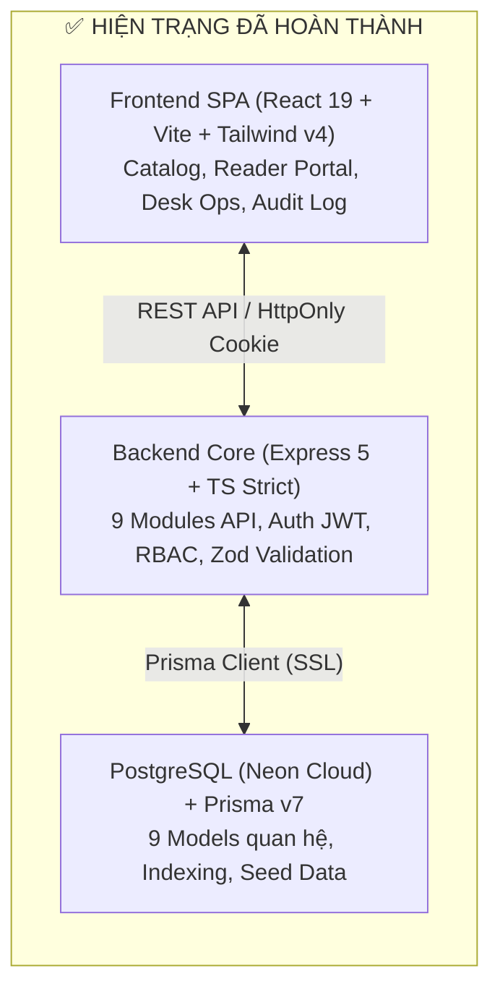
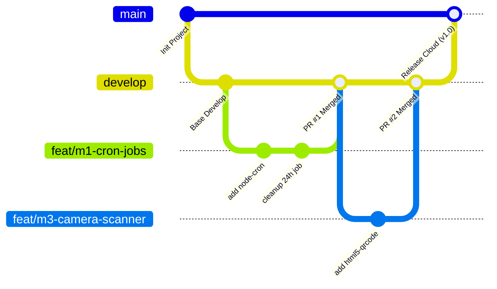

# BÁO CÁO HIỆN TRẠNG & KẾ HOẠCH PHÂN CÔNG THỰC HIỆN DỰ ÁN
## HỆ THỐNG QUẢN LÝ THƯ VIỆN (LIBRARY MANAGEMENT SYSTEM - LMS)

> **Thông tin tổng quan:**  
> - **Thời gian thực hiện dự kiến:** 3 - 4 tuần  
> - **Quy mô nhân sự:** Nhóm 4 người  
> - **Mô hình triển khai:** Node.js 20 LTS (Local) + Neon PostgreSQL + Render (Backend) + Vercel (Frontend) *(Không dùng Docker)*  
> - **Ngày lập kế hoạch:** 02/11/2026  

---

## PHẦN 1: BÁO CÁO NHỮNG GÌ ĐÃ HOÀN THÀNH

Dự án hiện đã hoàn tất xây dựng **Core Backend (Express 5 + TypeScript + Prisma)** và **Giao diện Frontend MVP (React 19 + Vite + Tailwind CSS v4)**. Cả hai phân hệ đều biên dịch thành công (build sạch, không phát sinh lỗi TypeScript hay Linting).



### 1. Phân hệ Backend (Node.js + Express 5 + TypeScript + Prisma)

Backend được tổ chức theo kiến trúc **Modular Layered Architecture** chuẩn mực (`routes` $\rightarrow$ `schema` $\rightarrow$ `controller` $\rightarrow$ `service`):

- **Xác thực & Bảo mật (Auth & RBAC):**
  - Đăng ký, đăng nhập với mã hóa mật khẩu `bcryptjs`.
  - Cơ chế Token kép: JWT Access Token lưu trong bộ nhớ/session và Refresh Token qua HttpOnly Cookie an toàn chống tấn công XSS.
  - Phân quyền theo 3 vai trò nghiêm ngặt: `READER` (Độc giả), `LIBRARIAN` (Thủ thư), `ADMIN` (Quản trị viên).
  - Tích hợp lớp phòng thủ: `helmet`, `cors`, `cookie-parser`, `express-rate-limit` chống Brute-force.
- **Quản lý Danh mục, Sách & Bản sao vật lý (Catalog & Inventory):**
  - Quản lý thể loại sách (`Category`) theo slug định danh duy nhất.
  - Quản lý đầu sách (`Book`): Tìm kiếm mờ theo tiêu đề, tác giả, ISBN; lọc theo danh mục; hỗ trợ phân trang chuẩn hóa.
  - Quản lý bản sao vật lý (`BookCopy`): Mỗi bản sao có Barcode duy nhất, vị trí kệ (`shelfLocation`), và trạng thái cụ thể (`AVAILABLE`, `RESERVED`, `BORROWED`, `DAMAGED`, `LOST`).
- **Nghiệp vụ Mượn / Trả & Concurrency Control (Borrow Engine):**
  - **Đặt sách trước (Reservation):** Tự động khóa bản sao trong 24 giờ. Kiểm tra hạn mức mượn tối đa (5 cuốn) và chặn người dùng có nợ phạt vượt ngưỡng. Toàn bộ logic chạy trong **Prisma Transaction** để triệt tiêu race condition (chống mượn trùng cuốn sách cuối cùng).
  - **Checkout tại quầy:** Thủ thư có thể quét/nhập nhiều bản sao cùng lúc cho 1 độc giả, kiểm tra trùng mã và cập nhật tồn kho tức thì.
  - **Trả sách (Return) & Tính phạt tự động:** Tiếp nhận và phân loại tình trạng sách (`GOOD`, `LIGHT_DAMAGE`, `HEAVY_DAMAGE`, `LOST`). Tự động tính phí trả trễ (5.000 VNĐ/ngày, có ân hạn 1 ngày, áp trần 150% giá sách) và phí bồi thường hư hại/mất sách.
  - **Gia hạn sách (Renew):** Cho phép độc giả tự gia hạn tối đa 2 lần (+7 ngày/lần) nếu sách chưa bị quá hạn.
- **Quản lý Tiền phạt & Nhật ký kiểm toán (Fine & Audit Log):**
  - Quản lý danh sách phạt, xác nhận thu tiền (`settle`).
  - Phê duyệt miễn giảm phạt (`waive`) dành riêng cho Admin (bắt buộc nhập lý do).
  - Tự động ghi vết thao tác miễn phạt và thay đổi trạng thái người dùng vào bảng `audit_logs`.

---

### 2. Phân hệ Cơ sở dữ liệu (PostgreSQL & Prisma ORM)

- Schema gồm 9 bảng thực thể liên kết chặt chẽ: `users`, `categories`, `books`, `book_copies`, `borrow_records`, `borrow_items`, `fines`, `system_settings`, `audit_logs`.
- Đánh chỉ mục (`@@index`) tối ưu hóa truy vấn tìm kiếm theo `email`, `role`, `isbn`, `barcode`, `dueDate`, `status`.
- Script seed dữ liệu mẫu (`prisma/seed.ts`) hoàn chỉnh, nạp sẵn tài khoản mẫu cho cả 3 vai trò cùng kho sách mẫu phong phú.

---

### 3. Phân hệ Frontend (React 19 + TypeScript + Vite + Tailwind CSS v4)

Giao diện SPA tuân theo ngôn ngữ thiết kế **“Quiet Academic Library”** (trang nhã, tập trung vào khả năng tra cứu và tốc độ thao tác tại quầy):

- **Xử lý State & Tự động Refresh Token:** Axios client tập trung, tự động bắt lỗi `401` để kích hoạt endpoint refresh token ngầm và retry request mà không làm gián đoạn người dùng.
- **Màn hình Độc giả (Reader):**
  - Tra cứu kho sách trực tuyến, xem vị trí kệ sách và tình trạng còn/hết.
  - Đặt giữ chỗ sách online (`Reserve`).
  - Trang cá nhân: Theo dõi danh sách sách đang mượn, lịch sử mượn, tự bấm gia hạn sách, theo dõi phí phạt cá nhân và xem mã QR định danh cá nhân.
- **Màn hình Vận hành (Librarian / Admin):**
  - Dashboard vận hành: Thống kê KPI tổng quan (đầu sách, bản sao khả dụng, đang mượn, quá hạn, nợ phạt).
  - Quản lý đầu sách, bản sao vật lý và danh mục sách.
  - Quầy Checkout: Nhập danh sách barcode, kiểm tra trùng lặp và xác nhận giao dịch.
  - Quầy Return: Tiếp nhận trả sách, đánh giá hỏng/mất.
  - Quản lý thu tiền phạt và miễn giảm tiền phạt.
  - Trang Audit Logs dành riêng cho Admin truy vết thao tác hệ thống.

---

## PHẦN 2: KẾ HOẠCH & PHÂN CÔNG CHI TIẾT CHO NHÓM 4 NGƯỜI (3 - 4 TUẦN)

### 1. Phân định vai trò và trách nhiệm (RACI)

| Thành viên | Vai trò | Trách nhiệm chính |
|---|---|---|
| **Member 1** | **Tech Lead & Backend Automation** | Cấu hình Background Cron jobs, Dịch vụ Email tự động, CRUD tham số `SystemSetting`, Deploy Backend lên Render và Quản lý tích hợp Git. |
| **Member 2** | **Backend Business & Data Services** | Xây dựng API Lookup cho quầy mượn/trả, Báo cáo thống kê chuyên sâu, Xuất file Excel/PDF, Tích hợp Upload ảnh bìa sách Cloudinary. |
| **Member 3** | **Frontend Lead & Scanner Specialist** | Tích hợp Camera QR/Barcode Scanner (`html5-qrcode`), Dashboard biểu đồ Recharts, Màn hình Admin (Quản lý Users & Cấu hình Settings). |
| **Member 4** | **QA / Full-Stack & Documentation** | Xây dựng bộ kiểm thử tự động (Jest + Supertest), Viết test chống Race Condition, Kiểm thử E2E liên thông, Soạn báo cáo đồ án, Slide & Kịch bản demo. |

---

### 2. Lộ trình triển khai chi tiết theo tuần

#### 🗓️ TUẦN 1: Tích hợp Camera Scanner, Dịch vụ Email & Cron Jobs
*Mục tiêu:* Đưa camera vào quét thực tế tại quầy, kích hoạt thông báo email và tự động hóa xử lý đơn đặt quá hạn.

- **Member 1 (Tech Lead / Automation):**
  - Cài đặt `node-cron`. Viết cron job tự động quét định kỳ: Hủy phiếu `RESERVED` sau 24h và hoàn trả bản sao về kho `AVAILABLE`.
  - Viết cron job hàng ngày (0h00) quét và cập nhật trạng thái phiếu quá hạn thành `OVERDUE`.
  - Cài đặt `nodemailer` (hoặc `resend` SDK sandbox) để gửi email chào mừng và email xác nhận khi checkout mượn sách thành công.
- **Member 2 (Backend Data Services):**
  - Viết API tra cứu tức thời cho quầy: `GET /api/v1/borrows/lookup?barcode=...` và `GET /api/v1/users/lookup?qrCode=...` để thủ thư tra nhanh phiếu mượn/độc giả.
  - Viết API sinh mã base64 QR Code cho User và Barcode cho sách.
  - Tích hợp upload ảnh bìa sách lên Cloudinary qua API (`multer-storage-cloudinary`).
- **Member 3 (Frontend Lead):**
  - Cài đặt `html5-qrcode`. Tạo Component dùng chung `<CameraScanner />` hỗ trợ cả webcam máy tính và camera điện thoại.
  - Tích hợp camera scanner vào quầy Checkout: Quét mã QR thẻ độc giả và quét liên tiếp các barcode sách.
  - Tích hợp camera scanner vào quầy Return: Quét mã vạch trên sách để tự động hiển thị phiếu mượn tương ứng.
- **Member 4 (QA & Testing):**
  - Thiết lập môi trường test với `jest`, `ts-jest`, `@types/jest`, `supertest`. Thêm lệnh `npm test`.
  - Viết Unit/Integration tests cho module `auth` (Đăng ký, Đăng nhập, Sai mật khẩu, Phân quyền RBAC).
  - Viết tests cho module `category` và `book` (Validation, CRUD, Soft-delete).

---

#### 🗓️ TUẦN 2: Báo cáo nâng cao, Xuất file Excel/PDF & Quản trị Admin
*Mục tiêu:* Trực quan hóa dữ liệu thống kê qua biểu đồ, xuất báo cáo file và hoàn thiện chức năng quản trị tài khoản/cấu hình.

- **Member 1 (Tech Lead / Automation):**
  - Xây dựng module `system-setting`: CRUD các tham số thư viện trong DB (Hạn mức mượn, thời hạn giữ chỗ, mức phạt/ngày, % phạt sách hỏng).
  - Viết Cron job gửi email nhắc hạn tự động trước 1–2 ngày khi tới hạn trả (`dueDate`).
  - Viết API quản lý tài khoản cho Admin: `GET /api/v1/users`, `PATCH /api/v1/users/:id/status` (Khóa/Kích hoạt), `PATCH /api/v1/users/:id/role`.
- **Member 2 (Backend Data Services):**
  - Nâng cấp `report.service.ts`: API Top 10 sách mượn nhiều nhất, API xu hướng mượn 6 tháng gần nhất, API cơ cấu thể loại sách.
  - Cài đặt `exceljs`: Viết API `GET /api/v1/reports/export/excel` xuất danh sách sách đang mượn & quá hạn.
  - Cài đặt `pdfkit`: Viết API `GET /api/v1/borrows/:id/receipt` in phiếu mượn/trả sách định dạng PDF.
- **Member 3 (Frontend Lead):**
  - Nâng cấp trang Báo cáo: Tích hợp thư viện `recharts` vẽ biểu đồ cột Top sách, biểu đồ đường lượt mượn theo tháng, biểu đồ tròn cơ cấu sách.
  - Thêm nút tải file báo cáo Excel và in phiếu mượn PDF.
  - Xây dựng 2 trang quản trị Admin: Màn hình quản lý danh sách Users và Màn hình cấu hình quy định thư viện (`/admin/settings`).
- **Member 4 (QA & Testing):**
  - Viết Integration tests cho module `borrow` và `fine`:
    - Test tính phạt quá hạn chuẩn xác (5.000đ/ngày, trần 150%).
    - Test chặn gia hạn khi đã quá 2 lần hoặc sách đã quá hạn.
  - **Viết test Race Condition (Kiểm thử tranh chấp):** Mô phỏng 2 request gửi đồng thời đặt mượn cuốn sách chỉ còn 1 bản sao khả dụng duy nhất $\rightarrow$ Xác nhận đúng 1 người thành công và 1 người nhận lỗi Conflict (409).

---

#### 🗓️ TUẦN 3: Triển khai Cloud (Render & Vercel), Test E2E & Tinh chỉnh UX
*Mục tiêu:* Đưa hệ thống lên môi trường online public, kiểm thử liên thông toàn bộ các vai trò và khắc phục triệt để lỗi.

- **Member 1 (Tech Lead / Cloud Deployment):**
  - Tạo Web Service trên **Render.com** cho Backend (kết nối repo GitHub, thiết lập build `npm run build`, start `npm start`).
  - Tạo project trên **Vercel** cho Frontend (biến môi trường `VITE_API_URL` trỏ về domain Render).
  - Cấu hình CORS giữa Vercel $\leftrightarrow$ Render, kiểm tra cookie refresh token hoạt động trơn tru qua giao thức HTTPS.
  - Thiết lập GitHub Actions CI workflow: Tự động chạy `npm run build` và `npm test` mỗi khi có pull request.
- **Member 2 (Backend Data Services):**
  - Rà soát bảo mật & Tối ưu hiệu năng: Kiểm tra các truy vấn Prisma, bổ sung index còn thiếu, đảm bảo không lộ thông tin nhạy cảm.
  - Viết Swagger/Scalar API Documentation trực quan tại route `/api/v1/docs` để phục vụ hội đồng nghiệm thu.
- **Member 3 (Frontend Lead):**
  - Tinh chỉnh Responsive trên điện thoại (đảm bảo thủ thư cầm smartphone quét camera mượt mà, không bị vỡ giao diện).
  - Thay thế các thông báo `alert` thô bằng Toast notifications đẹp mắt.
  - Hoàn thiện xử lý lỗi giao diện khi mất kết nối mạng (nút Retry).
- **Member 4 (QA & Testing):**
  - Thực hiện kiểm thử toàn diện E2E (End-to-End) theo hành trình thực tế:
    1. Độc giả đăng ký $\rightarrow$ Tìm kiếm sách $\rightarrow$ Đặt trước sách (Reserve).
    2. Thủ thư mở camera quét mã QR độc giả $\rightarrow$ Checkout giao sách.
    3. Độc giả kiểm tra hạn mượn $\rightarrow$ Bấm gia hạn thành công.
    4. Thủ thư quét mã trả sách $\rightarrow$ Báo hỏng nhẹ $\rightarrow$ Hệ thống tự sinh khoản phạt.
    5. Thủ thư thu tiền phạt / Admin miễn phạt $\rightarrow$ Kiểm tra nhật ký Audit Log.
  - Lập bảng tổng hợp Bug để các thành viên fix ngay trong tuần.

---

#### 🗓️ TUẦN 4: Đóng băng Code, Hoàn thiện Báo cáo & Tổng duyệt Thuyết trình
*Mục tiêu:* Đóng băng mã nguồn, nạp bộ dữ liệu demo chuẩn đẹp, hoàn thiện tài liệu báo cáo và diễn tập kịch bản demo.

- **Cả 4 thành viên (Code Freeze & Nạp Data):**
  - **Đóng băng mã nguồn (Hết thứ 3):** Ngừng phát triển tính năng mới, chỉ sửa lỗi hiển thị nhỏ.
  - Nạp bộ dữ liệu mẫu chuẩn (`prisma/seed.ts`) phong phú: Đủ ảnh bìa sách đẹp, các giao dịch đang mượn, quá hạn, đã trả, nợ phạt để dashboard demo sinh động.
- **Member 1 & Member 2 (Báo cáo kỹ thuật):**
  - Soạn tài liệu Báo cáo đồ án môn học hoàn chỉnh (Word/PDF):
    - Đặt vấn đề, phân tích nghiệp vụ (Business Rules).
    - Thiết kế kiến trúc hệ thống, biểu đồ ERD, sơ đồ Use Case, kiến trúc Cloud.
    - Chi tiết hiện thực các module trọng tâm (Concurrency, Background Jobs, Fine Engine).
    - Đánh giá kết quả kiểm thử và hướng phát triển tương lai.
- **Member 3 & Member 4 (Slide & Kịch bản Demo):**
  - Thiết kế bộ Slide thuyết trình PowerPoint/Canva chuyên nghiệp (15 - 20 slides, súc tích, nhiều hình ảnh minh họa).
  - Xây dựng Kịch bản Demo phân vai chi tiết (Người giới thiệu $\rightarrow$ Độc giả $\rightarrow$ Thủ thư tại quầy $\rightarrow$ Quản trị viên).
  - **Quay 01 Video Clip Demo hoàn chỉnh (5 - 7 phút)** làm phương án dự phòng (Backup) nếu buổi bảo vệ gặp sự cố mạng internet.
- **Cả nhóm (Tổng duyệt):**
  - Diễn tập thuyết trình thử ít nhất 2 lần, bấm giờ và chuẩn bị trước các câu hỏi vấn đáp hội đồng thường đặt ra.

---

### 3. Ma trận phân công nhiệm vụ theo tuần (WBS Matrix)

```
Tuần 1:
├── Member 1: Background Jobs (Overdue, Expiry) + Dịch vụ Email (Nodemailer/Resend)
├── Member 2: Desk Lookup API + Upload ảnh Cloudinary + API QR Base64
├── Member 3: Camera Scanner Component (html5-qrcode) + Tích hợp Desk Checkout/Return
└── Member 4: Cấu hình Jest & Supertest + Unit Tests Auth & Catalog

Tuần 2:
├── Member 1: System Settings API + Cron nhắc hạn trả sách trước 1-2 ngày
├── Member 2: API Báo cáo phân tích + Xuất file Excel (exceljs) & PDF (pdfkit)
├── Member 3: Biểu đồ Recharts + Màn hình Admin Quản lý Users & Cấu hình Settings
└── Member 4: Integration Tests Borrow/Return/Fine + Kiểm thử Race Condition

Tuần 3:
├── Member 1: Deploy Render & Vercel + Cấu hình CI GitHub Actions + SSL/CORS
├── Member 2: Tối ưu truy vấn Prisma + Swagger/Scalar API Docs + Rà soát bảo mật
├── Member 3: Responsive Mobile/Tablet + Toast Notifications + Tinh chỉnh UX
└── Member 4: Kiểm thử liên thông E2E + Quản lý sửa lỗi toàn diện

Tuần 4:
├── Member 1 & 2: Soạn thảo Báo cáo đồ án môn học hoàn chỉnh (Word/PDF)
├── Member 3 & 4: Thiết kế Slide báo cáo + Kịch bản Demo + Video clip backup
└── Cả nhóm: Code Freeze + Nạp dữ liệu Seed chuẩn + Tổng duyệt Thuyết trình
```

---

### 4. HƯỚNG DẪN QUY TRÌNH GIT CHI TIẾT DÀNH CHO TỪNG THÀNH VIÊN

Để 4 người làm việc song song không bao giờ bị đè code, mất code hoặc xung đột database, cả nhóm tuân thủ quy trình sau:



#### A. Cấu trúc nhánh (Branching Strategy)
- `main`: **Nhánh Production & Demo**. Luôn ở trạng thái chạy ổn định 100%. Render và Vercel sẽ tự động deploy mỗi khi nhánh này có commit mới. **Tuyệt đối KHÔNG push trực tiếp vào `main`**.
- `develop`: **Nhánh làm việc tích hợp chung** của cả 4 người. Mọi tính năng sau khi test xong sẽ merge vào đây.
- Nhánh tính năng cá nhân: Tạo tách ra từ `develop` theo quy ước:
  - Tính năng mới: `feat/<thành-viên>-<tên-chức-năng>` *(Ví dụ: `feat/m1-cron-jobs`, `feat/m3-camera-scanner`)*
  - Sửa lỗi: `fix/<thành-viên>-<tên-lỗi>` *(Ví dụ: `fix/m2-lookup-null`)*
  - Viết test: `test/<thành-viên>-<tên-test>` *(Ví dụ: `test/m4-concurrency-borrow`)*

---

#### B. Hướng dẫn thiết lập máy lần đầu (Setup Day 1 cho cả 4 bạn)

Mở Terminal (PowerShell hoặc Git Bash) chạy lần lượt các lệnh sau:

```bash
# 1. Clone repository về máy
git clone <URL_GITHUB_CUA_NHOM>
cd Library-Management-Application

# 2. Cấu hình định danh cá nhân trên Git
git config user.name "Nguyen Van A"
git config user.email "nguyenvana@gmail.com"

# 3. Cài đặt thư viện Backend
npm install

# 4. Cài đặt thư viện Frontend
cd frontend
npm install
cd ..

# 5. Cấu hình biến môi trường
cp .env.example .env
# Mở file .env và điền đúng chuỗi DATABASE_URL của Neon do Tech Lead cung cấp

# 6. Sinh mã Prisma Client tương thích với DB
npm run db:generate
```

---

#### C. Quy trình 6 bước làm việc hàng ngày (Daily Workflow)

Khi bắt đầu làm bất kỳ chức năng nào, từng thành viên thực hiện đúng 6 bước:

##### • Bước 1: Luôn cập nhật code mới nhất từ nhánh `develop`
```bash
git checkout develop
git pull origin develop
```

##### • Bước 2: Tạo nhánh riêng cho công việc của mình
```bash
# Cú pháp: git checkout -b feat/<mã-thành-viên>-<tên-task>
git checkout -b feat/m3-camera-scanner
```

##### • Bước 3: Viết code và test chạy thử ở máy local
- Mở Terminal 1 chạy Backend: `npm run dev`
- Mở Terminal 2 chạy Frontend: `cd frontend && npm run dev`
- Tiến hành code chức năng được giao.

##### • Bước 4: Kiểm tra chất lượng mã nguồn trước khi Commit (BẮT BUỘC)
Trước khi lưu code, chạy lệnh kiểm tra để chắc chắn không làm gãy dự án:
```bash
# Kiểm tra TypeScript và Build Backend
npm run build
npm run lint

# Kiểm tra Build Frontend (nếu có sửa frontend)
cd frontend
npm run build
cd ..
```
*(Nếu có lỗi màu đỏ xuất hiện, phải sửa hết trước khi đi tiếp).*

##### • Bước 5: Commit với thông điệp chuẩn (Conventional Commits)
```bash
# Xem các file vừa sửa
git status

# Đưa file vào vùng chờ commit
git add .

# Tạo commit theo mẫu rõ ràng:
git commit -m "feat(scanner): tich hop html5-qrcode vao quay checkout"
```
*Các tiền tố quy ước:*
- `feat(...)`: Thêm tính năng mới.
- `fix(...)`: Sửa lỗi.
- `test(...)`: Bổ sung test tự động.
- `docs(...)`: Sửa tài liệu, README, báo cáo.
- `refactor(...)`: Tối ưu hóa code cũ mà không đổi tính năng.

##### • Bước 6: Đẩy nhánh lên GitHub và tạo Pull Request (PR)
```bash
# Đẩy nhánh của bạn lên GitHub
git push -u origin feat/m3-camera-scanner
```
- Mở giao diện GitHub trên trình duyệt.
- Bạn sẽ thấy nút xanh: **Compare & pull request** $\rightarrow$ Click vào.
- **Base:** chọn `develop` $\leftarrow$ **Compare:** chọn `feat/m3-camera-scanner`.
- Nhắn vào nhóm Zalo/Discord: *"Nhờ Member 1 / Member 4 review giúp PR #12"*.
- Sau khi được duyệt và merge, quay lại máy local xóa nhánh cũ để dọn rác:
  ```bash
  git checkout develop
  git pull origin develop
  git branch -d feat/m3-camera-scanner
  ```

---

#### D. Hướng dẫn xử lý xung đột (Conflict Resolution)

Nếu khi pull code mà terminal báo: `CONFLICT (content): Merge conflict in ...`:

1. Không hoảng loạn! Mở file bị conflict bằng **VS Code**.
2. Bạn sẽ thấy các vùng code được đánh dấu:
   - `<<<<<<< HEAD (Current Change)`: Code hiện có trên máy bạn.
   - `=======`
   - `>>>>>>> develop (Incoming Change)`: Code mới từ đồng đội vừa đẩy lên.
3. Click vào nút chọn của VS Code:
   - **Accept Incoming Change** (Nếu lấy code mới của bạn mình).
   - **Accept Current Change** (Nếu giữ code của mình).
   - **Accept Both Changes** (Nếu muốn gộp cả hai).
4. Lưu file lại, sau đó chạy:
   ```bash
   git add .
   git commit -m "merge: giai quyet xung dot tu develop"
   ```

---

#### E. Hướng dẫn quy trình thay đổi Database (Prisma Migration)

> [!IMPORTANT]
> Tuyệt đối không sửa trực tiếp bảng trên giao diện Neon Console hoặc pgAdmin vì sẽ làm lệch Schema của cả nhóm!

1. **Khi bạn cần thêm bảng hoặc thêm cột mới:**
   - Mở file `prisma/schema.prisma` và sửa đổi.
   - Chạy lệnh tạo migration:
     ```bash
     npm run db:migrate
     # Nhập tên migration bằng tiếng Anh không dấu, ví dụ: add_email_notification
     ```
   - Prisma sẽ tự tạo 1 thư mục chứa file SQL trong `prisma/migrations/`.
   - Chạy `git add prisma/` và commit toàn bộ thay đổi lên Git.
2. **Khi bạn thấy đồng đội vừa merge thay đổi Database:**
   - Kéo code mới về: `git pull origin develop`
   - Chỉ cần chạy lệnh:
     ```bash
     npm run db:generate
     ```
   - Prisma sẽ tự cập nhật kiểu dữ liệu TypeScript mới nhất cho bạn code tiếp.

---

#### F. Bảng lệnh "Cứu hộ" khẩn cấp (Git Cheat-Sheet)

| Tình huống sự cố | Lệnh xử lý nhanh |
|---|---|
| Đang code dở mà cần chuyển gấp sang nhánh khác để xem code bạn mình | `git stash` *(cất code đi)* $\rightarrow$ `git checkout develop`<br>*(Khi quay lại nhánh cũ gõ:* `git stash pop`*)* |
| Viết nháp thử nghiệm bị lỗi lung tung, muốn xóa sạch để trở về trạng thái ban đầu | `git restore .` *(hủy thay đổi chưa commit)* |
| Lỡ commit nhầm file mật khẩu `.env` lên Git | `git rm --cached .env`<br>`git commit -m "fix: go bo .env khoi git"` |
| Muốn xem lịch sử commit dạng cây trực quan | `git log --oneline --graph --all` |

---

### 5. TIÊU CHÍ ĐÁNH GIÁ THÀNH CÔNG (CHECKLIST NGHIỆM THU)

- [ ] **Chạy online 100%:** Frontend trên Vercel, Backend trên Render, Database trên Neon (truy cập bằng điện thoại bất cứ lúc nào).
- [ ] **Nghiệp vụ hoàn chỉnh:** Đặt trước 24h $\rightarrow$ Quét camera Checkout $\rightarrow$ Gia hạn $\rightarrow$ Quét trả sách $\rightarrow$ Tính phạt tự động.
- [ ] **Tính năng nâng cao ghi điểm:**
  - Quét mã QR thẻ độc giả và Barcode sách trực tiếp bằng Camera.
  - Gửi email thông báo tự động (mượn sách, nhắc hạn).
  - Tự động hủy đơn đặt mượn sau 24h bằng Cron job.
  - Xuất báo cáo danh sách sách quá hạn ra file Excel và in biên lai PDF.
  - Bằng chứng test chứng minh **không bị lỗi Race Condition** khi mượn cuốn sách cuối cùng.
- [ ] **Chất lượng kỹ thuật:** Code TypeScript Strict không lỗi `any`, có Unit/Integration tests tự động, tài liệu API đầy đủ.
- [ ] **Tài liệu nghiệm thu:** Báo cáo đồ án Word/PDF hoàn chỉnh, bộ slide thuyết trình đẹp mắt, video demo dự phòng 5-7 phút sẵn sàng.
